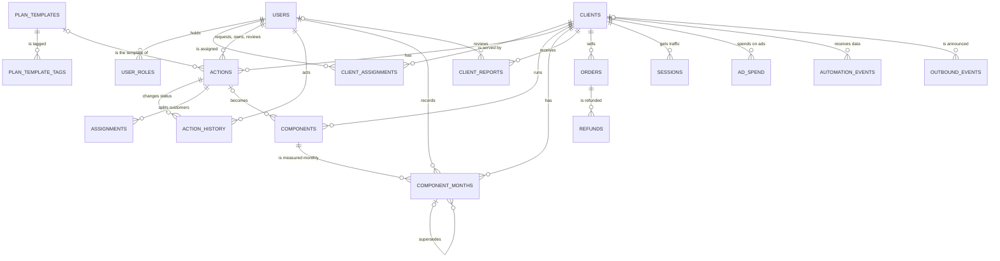

# Data model: MarketingOps v2 (Scaling)

> **How this file came about, honestly.** The Session 5 kit asks for the data
> model to be written *before* the schema. Here the order was the other way
> round: the tables were designed in the specification (`docs/specification-v2.md`
> §3, written 31 October to 2 November) and built as `schema/002_v2.sql` on
> 2 November, before Session 5. This file was assembled on 14 November from
> that schema, so the *Fields* section below is generated from the SQL and
> cannot drift from it. The parts marked ✍️ are design reasoning and are
> Carlos's to write.

## The app in one sentence

The consultants of a small growth agency (Scaling, fictional) use it to plan,
approve and measure growth actions for the online stores they advise, and to
keep each store's growth system on one ROI scoreboard.

## Entities (the things the app stores)

| Entity | One row means... |
|---|---|
| users | one person on the team, or one automation (a service user) |
| user_roles | one role held by one user (a user can hold several) |
| clients | one online store the agency advises |
| client_assignments | one consultant assigned to one store |
| plan_templates | one of the 72 ROI action plans, read-only reference |
| plan_template_tags | one fact about a plan: a metric it moves, or a kind of store it suits |
| actions | one growth action: a bounded test with a prediction fixed before it starts |
| action_history | one status change of an action (append-only) |
| assignments | one customer placed in an action's test or control group |
| components | one running part of a store's growth system, usually an adopted action |
| component_months | one month of a component's cost and measured benefit (append-only) |
| client_reports | one monthly report for a store: AI draft, human review, final text |
| orders | one order in a store's (fictional) shop data |
| refunds | one refund against an order |
| sessions | one day's sessions on one channel for a store |
| ad_spend | one day's ad spend on one channel for a store |
| automation_events | one event received from a Make automation, accepted or not |
| outbound_events | one ids-only announcement for Make to pick up |

## Relationships

- One **client** has many actions, components, component months, client
  reports, orders, sessions, ad-spend rows, and (optionally) automation and
  outbound events.
- One **user** holds many roles and can be assigned to many clients; each
  assignment row links one user and one client.
- One **user** requests many actions; an action may also have one owner and one
  reviewer (both users, both optional until assigned). The reviewer may be
  neither the requester nor the owner.
- One **plan template** has many tags and may be the starting point of many
  actions; an action may have no template.
- One **action** has many history rows and many assignments, and may become one
  or more **components**.
- One **component** has many component months; a corrected month points at the
  month it supersedes.
- One **order** has many refunds.

## The delete rule (my decision, with my reason)

If someone deletes a parent row that still has children (a client with
actions, an action with history, an order with refunds, any of them):

- [x] **RESTRICT**: block the delete. Every foreign key in the schema says
  `ON DELETE RESTRICT`.
- [ ] **CASCADE**
- [ ] **SET NULL**

Instead of deleting: clients and users are **deactivated** (`is_active = 0`),
actions are **cancelled**, and `action_history` and `component_months` cannot
be updated or deleted at all (triggers abort the change).

**I chose:** RESTRICT (decided 2 November, confirmed 14 November).

**Because:** ✍️ *Carlos to write, in business terms: who would be upset if a
deleted client took its actions, results and ROI history with it?*

## Other rules the database enforces

- **Append-only records:** `action_history` and `component_months` reject
  every UPDATE and DELETE (triggers). A correction is a new month row that
  points at the one it supersedes.
- **Each benefit is counted once:** one original measured row per client, month
  and `benefit_key` (`component_months_benefit_once`, a partial unique index).
- **One live report per store and month:** a rejected report does not count
  (`client_reports_one_live`).
- **A redelivered event changes nothing:** one *accepted* row per automation
  and external id; rejected and duplicate rows are still kept, so they can be
  counted (`automation_events_once`).
- **A component month belongs to its component's client** (trigger
  `component_months_client_matches`).
- **A person always has a password hash; an automation never has one** (table
  CHECK on `users`).
- **Missing costs stay missing:** order costs are nullable, never defaulted to
  zero, so figures that depend on them show as incomplete.

## Diagram

Primary and foreign keys of every table are in the field tables below.

## Fields

Generated from `schema/002_v2.sql` on 14 November 2026. SQLite has no date
type: dates and times are TEXT in ISO 8601 (`YYYY-MM-DD`, or
`YYYY-MM-DDTHH:MM:SSZ` in UTC); months are `YYYY-MM`. Money is euros as REAL.

### users

| Field | Type | Required? | Rules |
|---|---|---|---|
| id | INTEGER | yes | `PRIMARY KEY` |
| email | TEXT | yes | `UNIQUE` |
| full_name | TEXT | yes |  |
| password_hash | TEXT | no |  |
| is_service | INTEGER | yes | `DEFAULT 0 CHECK (is_service IN (0, 1))` |
| automation_name | TEXT | no | `UNIQUE` |
| is_active | INTEGER | yes | `DEFAULT 1 CHECK (is_active IN (0, 1))` |
| created_at | TEXT | yes | `DEFAULT (strftime('%Y-%m-%dT%H:%M:%SZ', 'now'))` |

Table rules: `CHECK ((is_service = 1 AND password_hash IS NULL) OR (is_service = 0 AND password_hash IS NOT NULL))`; `CHECK ((is_service = 1) = (automation_name IS NOT NULL))`

### user_roles

| Field | Type | Required? | Rules |
|---|---|---|---|
| user_id | INTEGER | yes | `REFERENCES users (id) ON DELETE RESTRICT` |
| role | TEXT | yes | `CHECK (role IN ('consultant', 'lead', 'admin', 'service'))` |

Table rules: `PRIMARY KEY (user_id, role)`

### clients

| Field | Type | Required? | Rules |
|---|---|---|---|
| id | INTEGER | yes | `PRIMARY KEY` |
| name | TEXT | yes | `UNIQUE` |
| sector | TEXT | yes |  |
| products | TEXT | yes |  |
| audience | TEXT | yes |  |
| main_channels | TEXT | yes |  |
| avg_order_value_eur | REAL | yes | `CHECK (avg_order_value_eur > 0)` |
| contribution_margin | REAL | yes | `CHECK (contribution_margin > 0 AND contribution_margin <= 1)` |
| purchase_frequency | TEXT | yes | `CHECK (purchase_frequency IN ('rare', 'occasional', 'monthly'))` |
| monthly_budget_eur | REAL | yes | `CHECK (monthly_budget_eur >= 0)` |
| roi_target | REAL | yes |  |
| hourly_rate_eur | REAL | yes | `DEFAULT 35 CHECK (hourly_rate_eur >= 0)` |
| business_model | TEXT | yes | `CHECK (business_model IN ('dtc', 'b2c', 'b2b', 'marketplace', 'subscription', 'omnichannel'))` |
| is_fictional | INTEGER | yes | `DEFAULT 1 CHECK (is_fictional IN (0, 1))` |
| is_active | INTEGER | yes | `DEFAULT 1 CHECK (is_active IN (0, 1))` |
| created_at | TEXT | yes | `DEFAULT (strftime('%Y-%m-%dT%H:%M:%SZ', 'now'))` |

### client_assignments

| Field | Type | Required? | Rules |
|---|---|---|---|
| user_id | INTEGER | yes | `REFERENCES users (id) ON DELETE RESTRICT` |
| client_id | INTEGER | yes | `REFERENCES clients (id) ON DELETE RESTRICT` |

Table rules: `PRIMARY KEY (user_id, client_id)`

### plan_templates

| Field | Type | Required? | Rules |
|---|---|---|---|
| id | INTEGER | yes | `PRIMARY KEY CHECK (id BETWEEN 1 AND 72)` |
| discipline | TEXT | yes | `CHECK (discipline IN ('ecommerce', 'digital_marketing', 'performance_marketing', 'digital_growth', 'agentic_ai', 'automations'))` |
| title | TEXT | yes |  |
| summary | TEXT | yes |  |
| benefit_type | TEXT | yes | `CHECK (benefit_type IN ('contribution', 'avoided_cost', 'enabler'))` |
| lifecycle_stage | TEXT | yes |  |
| default_window_days | INTEGER | yes | `CHECK (default_window_days > 0)` |
| default_post_period_days | INTEGER | yes | `CHECK (default_post_period_days >= 0)` |
| default_hurdle_eur | REAL | yes | `CHECK (default_hurdle_eur >= 0)` |
| setup_hours | REAL | yes | `CHECK (setup_hours >= 0)` |
| data_fit | TEXT | yes | `CHECK (data_fit IN ('yes', 'partial', 'no'))` |
| featured | INTEGER | yes | `DEFAULT 0 CHECK (featured IN (0, 1))` |
| source_file | TEXT | yes |  |

### plan_template_tags

| Field | Type | Required? | Rules |
|---|---|---|---|
| plan_template_id | INTEGER | yes | `REFERENCES plan_templates (id) ON DELETE RESTRICT` |
| kind | TEXT | yes | `CHECK (kind IN ('moves', 'business_model', 'purchase_frequency'))` |
| value | TEXT | yes |  |

Table rules: `PRIMARY KEY (plan_template_id, kind, value)`

### actions

| Field | Type | Required? | Rules |
|---|---|---|---|
| id | INTEGER | yes | `PRIMARY KEY` |
| client_id | INTEGER | yes | `REFERENCES clients (id) ON DELETE RESTRICT` |
| plan_template_id | INTEGER | no | `REFERENCES plan_templates (id) ON DELETE RESTRICT` |
| discipline | TEXT | yes | `CHECK (discipline IN ('ecommerce', 'digital_marketing', 'performance_marketing', 'digital_growth', 'agentic_ai', 'automations'))` |
| lifecycle_stage | TEXT | no | `CHECK (lifecycle_stage IN ('acquisition', 'activation', 'conversion', 'engagement', 'retention', 'repeat', 'expansion', 'referral', 'reactivation', 'operations'))` |
| title | TEXT | yes |  |
| hypothesis | TEXT | no |  |
| primary_metric | TEXT | no | `CHECK (primary_metric IN ('contribution', 'revenue', 'orders', 'sessions', 'conversion', 'average_order_value', 'new_customers', 'repeat_rate', 'cac', 'cpa', 'refund_rate', 'margin_pct', 'avoided_cost'))` |
| benefit_type | TEXT | yes | `CHECK (benefit_type IN ('contribution', 'avoided_cost', 'enabler'))` |
| expected_benefit_eur | REAL | no |  |
| setup_cost_eur | REAL | yes | `DEFAULT 0 CHECK (setup_cost_eur >= 0)` |
| setup_hours | REAL | yes | `DEFAULT 0 CHECK (setup_hours >= 0)` |
| operating_cost_eur | REAL | yes | `DEFAULT 0 CHECK (operating_cost_eur >= 0)` |
| operating_hours | REAL | yes | `DEFAULT 0 CHECK (operating_hours >= 0)` |
| hurdle_eur | REAL | yes | `DEFAULT 500 CHECK (hurdle_eur >= 0)` |
| comparison | TEXT | no | `CHECK (comparison IN ('holdout', 'before_after', 'invoice', 'none'))` |
| scope_channel | TEXT | no |  |
| window_start | TEXT | no |  |
| window_end | TEXT | no |  |
| post_period_days | INTEGER | no | `CHECK (post_period_days >= 0)` |
| requester_id | INTEGER | yes | `REFERENCES users (id) ON DELETE RESTRICT` |
| owner_id | INTEGER | no | `REFERENCES users (id) ON DELETE RESTRICT` |
| reviewer_id | INTEGER | no | `REFERENCES users (id) ON DELETE RESTRICT` |
| status | TEXT | yes | `DEFAULT 'submitted' CHECK (status IN ('submitted', 'assigned', 'in_review', 'approved', 'closed', 'rejected', 'cancelled'))` |
| measured_benefit_eur | REAL | no |  |
| confidence | TEXT | no | `CHECK (confidence IN ('holdout', 'before_after', 'correlated', 'documented'))` |
| evidence_note | TEXT | no |  |
| decision | TEXT | no | `CHECK (decision IN ('adopt', 'revise', 'reject', 'inconclusive'))` |
| decision_note | TEXT | no |  |
| early_stop_reason | TEXT | no | `CHECK (early_stop_reason IN ('data_quality_failure', 'technical_failure', 'customer_harm', 'financial_risk', 'legal_risk'))` |
| benefit_key | TEXT | no |  |
| created_at | TEXT | yes | `DEFAULT (strftime('%Y-%m-%dT%H:%M:%SZ', 'now'))` |

Table rules: `CHECK (reviewer_id IS NULL OR (reviewer_id <> requester_id AND (owner_id IS NULL OR reviewer_id <> owner_id)))`; `CHECK (comparison IS NULL OR (benefit_type = 'contribution' AND comparison IN ('holdout', 'before_after')) OR (benefit_type = 'avoided_cost' AND comparison = 'invoice') OR (benefit_type = 'enabler' AND comparison = 'none'))`; `CHECK (scope_channel IS NULL OR comparison IS NULL OR comparison = 'before_after')`; `CHECK (window_start IS NULL OR window_end IS NULL OR window_end > window_start)`

### action_history

| Field | Type | Required? | Rules |
|---|---|---|---|
| id | INTEGER | yes | `PRIMARY KEY` |
| action_id | INTEGER | yes | `REFERENCES actions (id) ON DELETE RESTRICT` |
| from_status | TEXT | no |  |
| to_status | TEXT | yes |  |
| actor_id | INTEGER | yes | `REFERENCES users (id) ON DELETE RESTRICT` |
| note | TEXT | no |  |
| created_at | TEXT | yes | `DEFAULT (strftime('%Y-%m-%dT%H:%M:%SZ', 'now'))` |

### assignments

| Field | Type | Required? | Rules |
|---|---|---|---|
| action_id | INTEGER | yes | `REFERENCES actions (id) ON DELETE RESTRICT` |
| customer_ref | TEXT | yes |  |
| group | TEXT | yes | `CHECK ("group" IN ('test', 'control'))` |
| assigned_at | TEXT | yes |  |

Table rules: `UNIQUE (action_id, customer_ref)`

### components

| Field | Type | Required? | Rules |
|---|---|---|---|
| id | INTEGER | yes | `PRIMARY KEY` |
| client_id | INTEGER | yes | `REFERENCES clients (id) ON DELETE RESTRICT` |
| origin_action_id | INTEGER | no | `REFERENCES actions (id) ON DELETE RESTRICT` |
| name | TEXT | yes |  |
| discipline | TEXT | yes |  |
| lifecycle_stage | TEXT | yes |  |
| benefit_type | TEXT | yes | `CHECK (benefit_type IN ('contribution', 'avoided_cost', 'enabler'))` |
| measurement | TEXT | no | `CHECK (measurement IN ('holdout_kept', 'pilot_estimate', 'invoice'))` |
| status | TEXT | yes | `DEFAULT 'running' CHECK (status IN ('running', 'review_due', 'retired'))` |
| started_on | TEXT | yes |  |
| retired_on | TEXT | no |  |
| benefit_key | TEXT | no |  |

Table rules: `CHECK ((benefit_type = 'enabler') = (measurement IS NULL))`

### component_months

| Field | Type | Required? | Rules |
|---|---|---|---|
| id | INTEGER | yes | `PRIMARY KEY` |
| component_id | INTEGER | yes | `REFERENCES components (id) ON DELETE RESTRICT` |
| client_id | INTEGER | yes | `REFERENCES clients (id) ON DELETE RESTRICT` |
| month | TEXT | yes | `CHECK (month GLOB '[0-9][0-9][0-9][0-9]-[0-9][0-9]')` |
| operating_cost_eur | REAL | yes | `DEFAULT 0 CHECK (operating_cost_eur >= 0)` |
| operating_hours | REAL | yes | `DEFAULT 0 CHECK (operating_hours >= 0)` |
| measured_benefit_eur | REAL | no |  |
| confidence | TEXT | no | `CHECK (confidence IN ('holdout', 'pilot_estimate', 'documented'))` |
| benefit_key | TEXT | no |  |
| runs | INTEGER | no | `CHECK (runs >= 0)` |
| failed_runs | INTEGER | no | `CHECK (failed_runs >= 0)` |
| hours_freed | REAL | no | `CHECK (hours_freed >= 0)` |
| supersedes_id | INTEGER | no | `REFERENCES component_months (id) ON DELETE RESTRICT` |
| recorded_by | INTEGER | yes | `REFERENCES users (id) ON DELETE RESTRICT` |
| created_at | TEXT | yes | `DEFAULT (strftime('%Y-%m-%dT%H:%M:%SZ', 'now'))` |

### client_reports

| Field | Type | Required? | Rules |
|---|---|---|---|
| id | INTEGER | yes | `PRIMARY KEY` |
| client_id | INTEGER | yes | `REFERENCES clients (id) ON DELETE RESTRICT` |
| month | TEXT | yes |  |
| draft_text | TEXT | yes |  |
| final_text | TEXT | no |  |
| status | TEXT | yes | `DEFAULT 'draft' CHECK (status IN ('draft', 'rejected', 'sent'))` |
| was_corrected | INTEGER | yes | `DEFAULT 0 CHECK (was_corrected IN (0, 1))` |
| rejection_reason | TEXT | no |  |
| model | TEXT | no |  |
| prompt_version | TEXT | no |  |
| generation_cost_eur | REAL | no | `CHECK (generation_cost_eur >= 0)` |
| reviewed_by | INTEGER | no | `REFERENCES users (id) ON DELETE RESTRICT` |
| reviewed_at | TEXT | no |  |
| created_at | TEXT | yes | `DEFAULT (strftime('%Y-%m-%dT%H:%M:%SZ', 'now'))` |

Table rules: `CHECK (status <> 'rejected' OR rejection_reason IS NOT NULL)`; `CHECK (status = 'draft' OR reviewed_by IS NOT NULL)`

### orders

| Field | Type | Required? | Rules |
|---|---|---|---|
| id | INTEGER | yes | `PRIMARY KEY` |
| client_id | INTEGER | yes | `REFERENCES clients (id) ON DELETE RESTRICT` |
| external_id | TEXT | yes | `UNIQUE` |
| ordered_at | TEXT | yes |  |
| customer_ref | TEXT | yes |  |
| is_new_customer | INTEGER | yes | `CHECK (is_new_customer IN (0, 1))` |
| channel | TEXT | yes |  |
| net_revenue_eur | REAL | yes | `CHECK (net_revenue_eur >= 0)` |
| discount_eur | REAL | yes | `DEFAULT 0 CHECK (discount_eur >= 0)` |
| product_cost_eur | REAL | no | `CHECK (product_cost_eur >= 0)` |
| shipping_cost_eur | REAL | no | `CHECK (shipping_cost_eur >= 0)` |
| payment_fee_eur | REAL | no | `CHECK (payment_fee_eur >= 0)` |

### refunds

| Field | Type | Required? | Rules |
|---|---|---|---|
| id | INTEGER | yes | `PRIMARY KEY` |
| order_id | INTEGER | yes | `REFERENCES orders (id) ON DELETE RESTRICT` |
| external_id | TEXT | yes | `UNIQUE` |
| refunded_at | TEXT | yes |  |
| amount_eur | REAL | yes | `CHECK (amount_eur >= 0)` |
| restocked_cost_eur | REAL | yes | `DEFAULT 0 CHECK (restocked_cost_eur >= 0)` |

### sessions

| Field | Type | Required? | Rules |
|---|---|---|---|
| id | INTEGER | yes | `PRIMARY KEY` |
| client_id | INTEGER | yes | `REFERENCES clients (id) ON DELETE RESTRICT` |
| date | TEXT | yes |  |
| channel | TEXT | yes |  |
| sessions | INTEGER | yes | `CHECK (sessions >= 0)` |

Table rules: `UNIQUE (client_id, date, channel)`

### ad_spend

| Field | Type | Required? | Rules |
|---|---|---|---|
| id | INTEGER | yes | `PRIMARY KEY` |
| client_id | INTEGER | yes | `REFERENCES clients (id) ON DELETE RESTRICT` |
| date | TEXT | yes |  |
| channel | TEXT | yes |  |
| spend_eur | REAL | yes | `CHECK (spend_eur >= 0)` |

Table rules: `UNIQUE (client_id, date, channel)`

### automation_events

| Field | Type | Required? | Rules |
|---|---|---|---|
| id | INTEGER | yes | `PRIMARY KEY` |
| source | TEXT | yes |  |
| client_id | INTEGER | no | `REFERENCES clients (id) ON DELETE RESTRICT` |
| event_type | TEXT | yes |  |
| external_id | TEXT | yes |  |
| payload | TEXT | yes |  |
| status | TEXT | yes | `CHECK (status IN ('accepted', 'rejected', 'duplicate'))` |
| reason | TEXT | no |  |
| expected_rows | INTEGER | no |  |
| parsed_rows | INTEGER | no |  |
| expected_revenue_eur | REAL | no |  |
| parsed_revenue_eur | REAL | no |  |
| received_at | TEXT | yes | `DEFAULT (strftime('%Y-%m-%dT%H:%M:%SZ', 'now'))` |

### outbound_events

| Field | Type | Required? | Rules |
|---|---|---|---|
| id | INTEGER | yes | `PRIMARY KEY` |
| event_type | TEXT | yes |  |
| client_id | INTEGER | no | `REFERENCES clients (id) ON DELETE RESTRICT` |
| entity_id | INTEGER | no |  |
| created_at | TEXT | yes | `DEFAULT (strftime('%Y-%m-%dT%H:%M:%SZ', 'now'))` |
| delivered_at | TEXT | no |  |

## Things to look at (found while writing this file)

Not changed: each is a question for Carlos, to decide or to explain.

- ⚠ **`orders.external_id` and `refunds.external_id` are UNIQUE across all
  stores, not per store.** Two stores that both have an order "1001" could not
  both be loaded; the second batch would be rejected. A per-store rule would be
  `UNIQUE (client_id, external_id)`.
- ⚠ **`clients.roi_target` has no CHECK.** Any number, including a negative
  one, is accepted.
- ⚠ **`plan_templates.lifecycle_stage`, `components.discipline` and
  `components.lifecycle_stage` have no CHECK**, while the same fields on
  `actions` do. The app checks plan templates when they are loaded.
- ⚠ **Dates are not format-checked** except `component_months.month`. The API
  checks the shape of the dates it receives (`routes/api.py`), but the database
  itself would accept the text "yesterday".

## Health check (`tools/check_db.py`, 14 November)

Run on a freshly generated demo database with `--src .`; the full output is in
[`evidence/session05/check_db-2026-11-14.txt`](evidence/session05/check_db-2026-11-14.txt).

- ✓ 18 tables found; **no orphan rows**; `PRAGMA foreign_keys = ON` set in
  `db.py`, and every connection in the app, the generator and the tests goes
  through `db.connect()`; no lists used as in-memory storage.
- ✗ **11 lines build SQL with an f-string** (`routes/actions.py` 149, 250, 277;
  `routes/admin.py` 35; `scripts/generate_shop_data.py` 247, 538;
  `tests/conftest.py` 142; `tests/test_api.py` 24; `tests/test_generator.py`
  46, 48). In every one, what the f-string inserts is a **column or table
  name taken from a fixed list in the code** (`TEXT_FIELDS`, `MONEY_FIELDS`,
  `CLIENT_TEXT`, a test's table list); the values always go in through `?`
  placeholders. ✍️ *Carlos to decide and explain: keep them, with that reason,
  or rewrite them as fixed SQL so the tool reports none.*
- ⚠ `assignments` has **no primary key**; its rows are kept unique by
  `UNIQUE (action_id, customer_ref)` instead.
- ⚠ 14 tables get "no UNIQUE / no CHECK / no NOT NULL" warnings; most are link,
  log or measurement tables. ✍️ *Each warning is a question to answer here.*
- ⚠ No `schema_migrations` table: the schema is applied with
  `flask --app app init-db`, not the kit's `migrate.py` (decision 12A).

**Restart test (14 November):** a client ("Restart Test Store") added through
the app on a scratch copy of the demo database was still there after the app
was stopped and started again
([screenshot](evidence/session05/restart-test-after-restart.jpg)). The sign-in
did not survive the restart: with no `SECRET_KEY` set, each run uses a new
random key (by design, since Week 3).

## What I changed after testing

| Date | What changed | What testing showed |
|---|---|---|
| 28 Oct | Every connection switches foreign keys on (`connect()` in `db.py`) | A fresh SQLite connection let a project be deleted and left its rows orphaned: foreign keys are off by default |
| 2 Nov | A racing duplicate event is recorded as a duplicate, not an error | The code review found that two copies of one event arriving together ended in an error 500 |
| 4 Nov | A rejected shop-data batch frees its `external_id` (partial unique index, accepted rows only) | A corrected batch could not be resent under the same id after its first copy was rejected |
| 4 Nov | `actions.scope_channel`, with a CHECK that it goes with a before/after comparison | A media action's saving was measured on the whole store, so it showed as zero |
| 14 Nov | The webhook rejects malformed rows before anything is written, and caps long ids and text (`routes/api.py`) | 30 bad-input tests: 11 inputs crashed the app with a 500, and 100,000-character values were accepted |
| ✍️ | *Session 5 findings, to add after the predict-then-prove tests* | |
