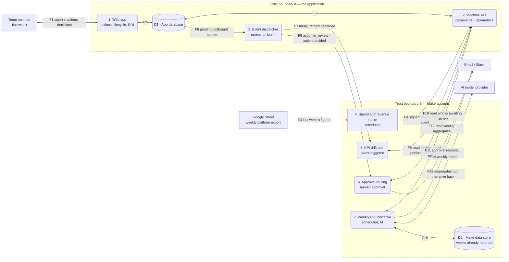

# Level-1 data flow diagram

Brief requirement 4: *every external entity, process, data store and trust
boundary.* Two trust boundaries: the **application** (Flask and its database,
hosted on AWS Lightsail from Week 10) and the **Make account** that runs the
four automations. Everything outside both is controlled by someone else.

The reviewer reaches the decision through **F1**: the message on F11 carries
only a link, and the approval itself is made signed in to the application. A
decision never travels through Make.

## The flows

| Flow | From | To | Data | Crosses a boundary |
|---|---|---|---|---|
| F1 | Team member | 1. Web app (both ways) | Credentials, action forms, lifecycle decisions, pages | **Yes** — internet ↔ app |
| F2 | 1. Web app | D1 (both ways) | Action, history, task, target and measurement records | No |
| F3 | Google Sheet | 4. Intake | Last week's spend, sessions, conversion, order value | **Yes** — Google ↔ Make |
| F4 | 4. Intake | 2. Machine API | Signed `spend_revenue` event, one per KPI | **Yes** — Make ↔ app |
| F5 | 2. Machine API | D1 (both ways) | Events in; aggregates out | No |
| F6 | D1 | 3. Event dispatcher | Outbound events not yet delivered | No |
| F7 | 3. Event dispatcher | 5. Drift alert | `measurement.recorded` — ids only | **Yes** — app ↔ Make |
| F8 | 5. Drift alert | 2. Machine API (both ways) | Signed read of the KPI against target; signed `performance` event | **Yes** — Make ↔ app |
| F9 | 3. Event dispatcher | 6. Approval routing | `action.in_review`, `action.decided` — ids only | **Yes** — app ↔ Make |
| F10 | 6. Approval routing | 2. Machine API (both ways) | Signed read: actions awaiting review, the named reviewer's email, days waiting | **Yes** — Make ↔ app |
| F11 | 6. Approval routing | Email / Slack | Approval request, reminder, outcome — action number and link only | **Yes** — Make ↔ mail provider |
| F12 | 7. ROI narrative | 2. Machine API (both ways) | Signed read of the week's aggregates | **Yes** — Make ↔ app |
| F13 | 7. ROI narrative | AI model provider (both ways) | Aggregates and confidence labels out; narrative text back | **Yes** — Make ↔ AI provider |
| F14 | 7. ROI narrative | Email / Slack | The weekly report | **Yes** — Make ↔ mail provider |
| F15 | 7. ROI narrative | D2 (both ways) | Which ISO weeks have already been reported | No |

Eleven flows cross a trust boundary. Each one has at least one threat and a
mitigation in [`stride.md`](stride.md).

## Three design choices the diagram makes visible

**No automation touches D1.** Every flow from Make reaches the database only
through process 2, the machine API, which validates, signs and de-duplicates.

**The application announces; it does not push data.** F7 and F9 carry ids, not
content. Make then reads what it needs over a signed call (F8, F10), so a forged
announcement makes Make read the true state and do nothing.

**The AI provider sees aggregates only.** F13 carries numbers and confidence
labels — never action titles, hypotheses or names. Text that people typed is
the one input that could carry instructions into a prompt.
