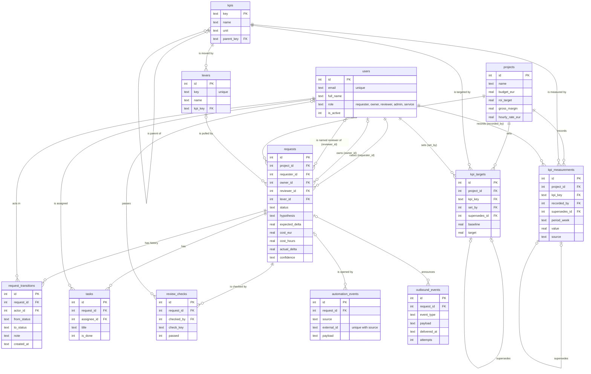

# Data model — entity relationship diagram

Brief requirement 1: *at least 3 related tables, each with a primary key and the
foreign keys that link them.* MarketingOps has twelve. The DDL is
[`schema/001_initial.sql`](../../schema/001_initial.sql); field-level detail is in
[`specification.md` §3](../specification.md#3--entities).

## What the diagram is saying

**`requests` is the central table**, as `Ticket` is in the brief's helpdesk
example. It points at `users` three times — the person who asked, the
specialist who does the work and the reviewer named to sign it off — and the
rule that the reviewer is neither of the other two is enforced twice: by a
`CHECK` on the table and by `check_transition()` in `lifecycle.py`.

**Three tables only ever grow:** `request_transitions`, `kpi_targets` and
`kpi_measurements`. Database triggers abort any `UPDATE` or `DELETE`. A changed
target or a corrected figure is a new row whose `supersedes_id` points at the
one it replaces — the self-relationships in the diagram — so the history of
every number stays visible.

**`kpis` and `levers` are fixed reference data.** The KPI tree (gross profit ←
revenue ← sessions × conversion rate × average order value) is seeded by the
schema and never edited by users; each lever moves exactly one leaf KPI.

**Two tables belong to the automations.** `automation_events` is where the
automations' writes land, unique on `(source, external_id)` so a redelivery
changes nothing. `outbound_events` is the outbox: the events the application
announces to Make, written in the same transaction as the change they announce.

## The delete rule

The Week 5 sheet asks what happens to a project's tasks when the project is
deleted. Here nothing on the record is deleted: actions are cancelled, numbers
are superseded, users are deactivated or pseudonymised (see
[`gdpr.md`](gdpr.md)). Whether a whole project should be archivable is still an
open decision ❓ ([`specification.md` §10](../specification.md#10--open-questions-for-the-session-)).
