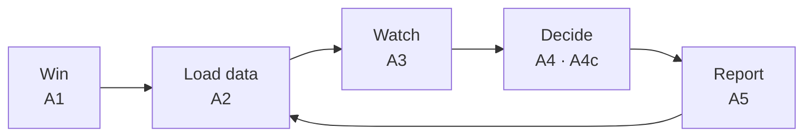

# Automation strategy — Scaling

*Drafted with Claude Code, 16 November 2026, from the repository (spec v2 §8,
`portfolio-plan.md`, `routes/api.py`, `config.py`) and the live Make account;
to be declared in the AI-usage log. Updated the same day to the numbering used
in Make (A1–A5) and to what is now built. The business-problem figures (who,
how often, minutes) and the choice of which automations go into CA1 are
Carlos's.*

---

## 1 · Strategy: what the automations are for

**The app's job.** Scaling advises several online stores. Every growth action
is a bounded test: a prediction fixed before it starts, an approval, a measured
result, a decision. Adopted actions become running components, judged on
contribution ROI. The app is the source of truth for all of it.

**The automations' job, in one sentence:** *keep the predict-then-prove loop
moving without anyone copying data or chasing people, and never let a machine
make a decision a person should make.*

| # | Goal | What it means in practice |
|---|---|---|
| G1 | **Fresh, trusted data** | Each store's orders, sessions and ad spend arrive daily; a batch that misses its control totals is rejected whole and someone is told |
| G2 | **Nothing slips** | A component below target, a test whose window ended, an action waiting for approval or a report waiting for review is noticed within a day |
| G3 | **People decide, on the record** | Approvals and report sign-off happen signed in to the app, by the named person; Make only routes and chases |
| G4 | **The system watches itself** | Every run and every failure is logged in one place, and a silent stop is noticed |

*Scaling's own Make scenarios are agency plumbing, not components of a client's
growth system: `components` and `component_months` belong to a client, so these
scenarios' runs and costs are tracked in the run log, not in the app's ROI.*

**Five rules every automation obeys** (from spec v2):

1. **Make moves data and messages; the app computes and decides.** No threshold, ROI figure or approval lives in a Make router.
2. **Only through the signed API.** `X-Automation` + `X-Signature` (HMAC-SHA256), one secret and one scope per automation. A POST signs its body; a GET signs its path and query. No automation touches the database.
3. **Doorbells, not deliveries.** The app announces changes with ids only; Make reads what it needs back over a signed `GET`.
4. **Idempotent.** Every write carries an `external_id`; firing twice changes nothing.
5. **Fail visibly.** Every scenario has an error route that writes to the run log and emails the team. Nothing stops silently.

---

## 2 · Structure

### The client loop, and where each automation sits

### Three kinds of trigger

| Trigger | Used when | Automations |
|---|---|---|
| **Schedule** | Work happens in batches at a known time | A2, A4c, A5 |
| **App event (webhook)** | The app has just changed something | A3, A4 |
| **Outside event (mailhook)** | Someone outside the app acts | A1 |

### Shared plumbing

| Piece | Where | Status |
|---|---|---|
| Signed API: `POST /api/events`; `GET /api/clients`, `/api/alerts`, `/api/reviews`, `/api/actions/<id>`, `/api/metrics` | app | Built (commit 07f27d8) |
| Outbox sender — posts `data.loaded` and `action.*` announcements to Make, marks them delivered, keeps the rest for `flask --app app send-announcements` | app | Built |
| One Make webhook per receiving scenario (A3, A4) | Make | Created |
| Shop-data feed Sheet — one row per store per day (1 Nov 2026 – 31 Jan 2027), with the export's own control totals | Google Sheets, from `scripts/export_shop_feed.py` | Created |
| Run log Sheet — every scenario writes its outcomes and errors | Google Sheets | Created |
| Team variables: app URL, team inbox, demo inbox, one HMAC secret per automation | Make | Created; the four secrets are still placeholders. **Carlos's decision (16 Nov, confirmed 17 Nov): the secrets live in Make team variables**, which Make stores unencrypted; see *Credentials* below |
| Reachability — Make cannot call `localhost` | hosting | **Open:** the app must be deployed or tunnelled before A2–A5 can run |

### Credentials: where the secrets live, and the remaining risk

**Where each secret is kept**

| Secret | In the app | In Make |
|---|---|---|
| One signing key per automation (A2 `shop_intake`, A3 `below_target_alert`, A4 `approval_routing`, A5 `report_draft`) | `.env` (`API_SECRET_*`), never committed; names listed in [`.env.example`](../../.env.example) | Team variables `secret_*` |
| Key that signs the app's announcements to Make | `.env` (`OUTBOX_SECRET`) | — |
| Session cookie key | `.env` (`SECRET_KEY`) | — |
| Make webhook addresses (A3, A4) | `.env` (`MAKE_WEBHOOK_*`) | The webhooks themselves |

**Options considered (17 Nov 2026).** Make's encrypted keychain cannot calculate the HMAC signature the app checks: its Encryptor app offers AES, PGP and an RSA "digital signature", and the `sha256()` function takes the key as plain text. So the realistic choices were:

| Option | Secret readable in Make? | Effect on the app |
|---|---|---|
| Team variables (chosen) | Yes, to anyone with access to the team | None |
| A plain API key in Make's encrypted HTTP keychain | No | The app would stop checking that the message body was not altered |
| RSA signature: private key in Make's keychain, public key in the app | No, for Make → app | New library and API change; Make would still need a readable key to check the app's announcements (A3, A4) |
| Move off Make | Depends | Rebuild all five automations |

**Decision (Carlos, 16 Nov, confirmed 17 Nov):** team variables, with the mitigations below.
✍️ *Why — Carlos to write: the trade-off in his own words.*

**Mitigations**

| Mitigation | Status |
|---|---|
| Each automation has its own key and only its own permissions (`AUTOMATION_SCOPES` in `config.py`): a leaked A2 key can send shop data and list the stores' ids and names, but cannot read metrics or reviews | Built |
| Only Carlos is a member of the Make team "CCT APP" | ✍️ to confirm |
| Two-factor sign-in on Carlos's Make account (the organisation does not enforce it) | ✍️ to confirm |
| Rotation: generate new keys, update `.env` and the four team variables, restart the app (about 10 minutes, with the local `set-secrets` script) | Procedure ready, not yet rehearsed |
| Check on the first run whether a key appears in Make's execution logs | To check on the first A2 run |
| Secrets never in the repo; GitHub and the Week 8 scanners would flag any that slipped in | In place |

---

## 3 · The list

### The five for the course

| # | Automation | Trigger | Systems | Brief requirement | Status |
|---|---|---|---|---|---|
| **A1** | Reply to a new inquiry | Mailhook | Gmail, AI (classify), Google Sheets | CA1: AI step + branching | **Built, active** — error routes still missing on three modules |
| **A2** | Daily shop-data intake | Schedule 06:00 | Google Sheets, app | CA2: **scheduled** | Built in Make, inactive, not yet run |
| **A3** | Below-target / window-ended alert | App event `data.loaded` | app, Gmail | CA2: **event-triggered** | Built in Make, inactive, not yet run |
| **A4** | Approval routing: ask the reviewer, tell the requester | App events `action.review_requested`, `action.approved`, `action.rejected` | app, Gmail | CA2: **human approval** | Built in Make, inactive, not yet run |
| **A4c** | Approval reminders | Schedule weekdays 09:00 | app, Gmail | part of A4 | Built in Make, inactive, not yet run |
| **A5** | Monthly AI client report draft | Schedule day 1, 07:00 | app, AI, Make data store, Gmail | CA1: second AI step | Built in Make, inactive, not yet run |

### One paragraph each

- **A1 · Inquiry reply.** A filter drops automatic and own-domain mail; the AI step sorts the email into one of five labels (`inquiry`, `job_seeker`, `supplier`, `spam`, `other`; anything unrecognised becomes `other`); the label is logged with no personal data; inquiries get a templated reply with the intake-form link (unless one was sent in the last 30 days) and the team is told; `job_seeker`, `supplier` and `other` go to the team by hand; spam is only logged. *Why AI and not a rule:* a keyword rule cannot tell a store owner's question from a supplier's pitch that uses the same words.
- **A2 · Shop-data intake.** The app says which day each store needs next; Make loads the missing days in order (at most 31 per run) from the feed Sheet and sends each one unchanged, with the export's own control totals. The app accepts or rejects the batch whole; a refusal is logged and emailed with the app's reason.
- **A3 · Below-target alert.** On `data.loaded`, Make asks the app which flags exist (system or component below the ROI target, or a test that finished measuring with no result), records each one (`external_id` = one per item per month) and emails the client's consultants only for new ones.
- **A4 · Approval routing.** On an action event, Make reads the action's true state and asks the named reviewer, or tells the requester the outcome. The decision is made **in the app**; the email has no approve button. **A4c** reminds reviewers of actions waiting two business days or more.
- **A5 · AI client report.** For each client, if last month is not drafted yet, Make reads the month's aggregates (no rows, no emails), the AI drafts the report under fixed rules (prompt `prompts/a5-report-v1.txt`), and the draft is saved in the app as `draft`. A consultant approves, corrects or rejects it; nothing reaches the client automatically.

### Optional, not built

| # | Automation | Why it could earn its place | App work it would need |
|---|---|---|---|
| A6 | Intake form → draft client | Saves retyping ~20 form answers | A database change: `clients` has no draft state |
| A7 | Stale-data watchdog | Catches A2 stopping silently | A flag in `/api/clients` |
| A8 | Monthly results reminder | Asks owners to record a component's month before A5 runs | A list of components with no row for last month |
| A9 | Send the approved report to the client | Human approval inside one workflow (draft → approve → send) | A `report.sent` announcement and a client contact email |
| A10 | Monthly ops summary | Runs, failures and operations per scenario, for CA1's cost commentary | None (Make API → run log) |

---

## 4 · Against the two briefs

| Requirement | Covered by |
|---|---|
| CA2: ≥ 3 automations — scheduled, event-triggered, human approval | A2 · A3 · A4 |
| CA1: 3–4 *genuine* processes that actually run | Carlos's choice among A1–A5. A1 runs on a real mailbox; A2–A5 serve a fictional agency and stores, which the brief may treat as contrived — the framing is his |
| CA1: survive empty field, malformed input, API error | Error routes in every scenario + the app's 4xx refusals |
| CA1: ≥ 2 SaaS; ≥ 2 systems in one process | Gmail, Google Sheets, Make AI; A1 alone uses three |
| CA1: ≥ 1 branching step | Routers in A1–A5 |
| CA1: ≥ 1 AI step, and why a rule couldn't do it | A1 (classify), A5 (draft) |
| CA1: prompts verbatim, including failed versions | A1 and A5 — keep every version |
| CA1: credentials and personal data | One secret per automation; personal data = staff emails (A3, A4), prospect emails (A1) |

---

## 5 · What is left

| Step | What | Who |
|---|---|---|
| 1 | Replace the four placeholder secrets in Make and put the same values in `.env`; add the webhook URLs and `OUTBOX_SECRET` to `.env` | Carlos |
| 2 | Make the app reachable (deploy or tunnel) and set `scaling_app_url` | Carlos, with help |
| 3 | Run each scenario once by hand and check the run log: confirms Make's signature matches the app's and that the Sheet search finds each day | together |
| 4 | Add error routes to A1's AI step, Sheet log and Gmail search | Claude, on request |
| 5 | Business-problem figures and the CA1 choice | Carlos |
